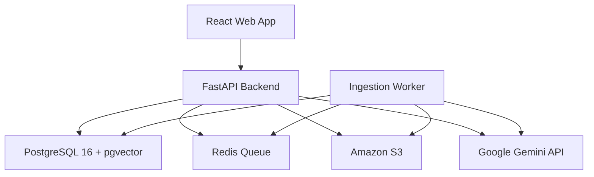
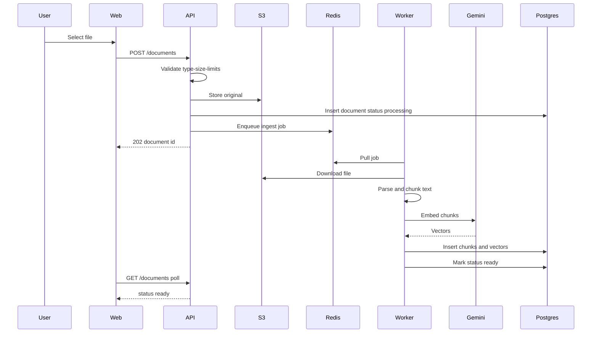
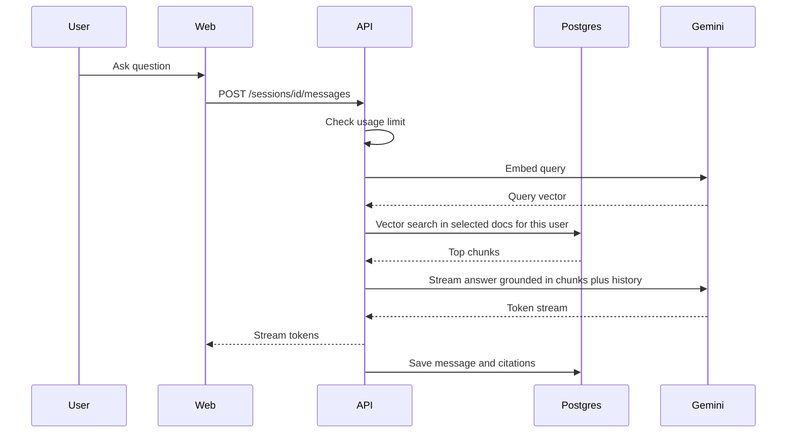
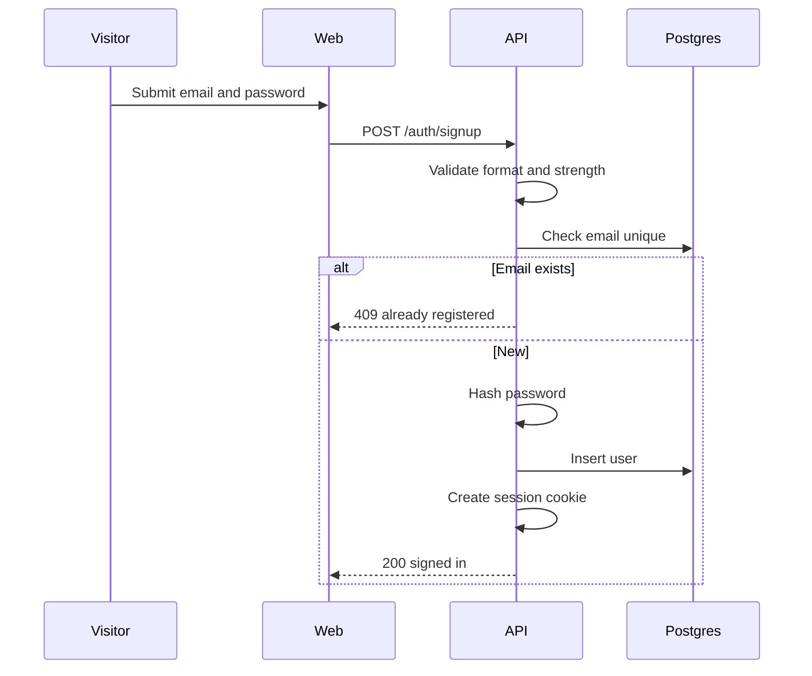
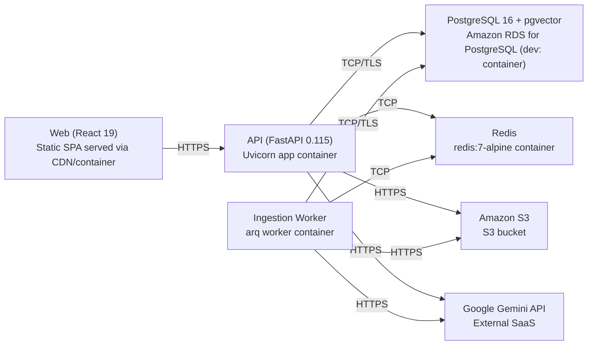

# Architecture

> Maintained by QuorQ AI SDLC. Text between `sdlc:auto` markers is regenerated; anything outside them is yours and is kept.

<!-- sdlc:auto:start narrative -->
## Overview

### ARCH-001 · approved · source: architecture:summary

Approved v2 architecture for a RAG chatbot where signed-in users upload their own documents, which are asynchronously parsed/chunked/embedded via gemini-embedding-001 into pgvector, then queried in document-scoped chat sessions answered by gemini-2.5-flash with citations.

Status: approved, Version 2. Stack: React 19 frontend; FastAPI 0.115 backend with Redis-backed async ingestion workers; PostgreSQL 16 with pgvector for all relational and vector data under strict per-user isolation; Amazon S3 for original file storage; Google Gemini as the sole AI provider. Auth is session-based email+password with no email verification at launch. Per-user usage limits bound Gemini cost for a free-at-launch product.

- ⚠ No explicit traceability from this architecture document to specific US-00x requirement ids was provided -- mapping below is inferred from functional description only, not stated directly in the input.
- ⚠ Numeric usage-limit thresholds and password-strength rules are referenced but not quantified in this input.

### ARCH-COMP-web · approved · source: architecture:components:web

React 19 web app provides the dashboard and chat UI.

Responsive dashboard and chat UI covering sign-up/sign-in, document upload with live status, session management, and streaming grounded answers with citations.

### ARCH-COMP-api · approved · source: architecture:components:api

FastAPI backend is the single entry point for auth, document/session CRUD, retrieval and answer generation.

Handles session-based auth, per-user authorization and isolation, document CRUD and upload to S3, session/message CRUD, retrieval and streaming answer generation, usage-limit enforcement, and enqueueing of ingestion jobs.

### ARCH-COMP-worker · approved · source: architecture:components:worker

Ingestion worker (arq, FastAPI 0.115 runtime) performs background document processing.

Consumes ingestion jobs from Redis: downloads file from S3, parses text, chunks it, embeds with gemini-embedding-001, writes chunks+embeddings to pgvector, and updates per-document status to ready or failed.

### ARCH-COMP-db · approved · source: architecture:components:db

PostgreSQL 16 + pgvector is the single system of record for relational and vector data.

Stores users, documents, chunks with vector embeddings, chat sessions, messages and citations; enforces per-user isolation and cascade deletion.

### ARCH-COMP-queue · approved · source: architecture:components:queue

Redis 7 queue decouples upload acceptance from background ingestion processing.

Durable job queue used to hand off parse/chunk/embed work from the API to the ingestion worker.

### ARCH-COMP-storage · approved · source: architecture:components:storage

Amazon S3 stores original uploaded documents durably.

Durable object storage for original uploaded documents (up to ~25MB each), enabling re-processing and re-download.

### ARCH-COMP-gemini · approved · source: architecture:components:gemini

Google Gemini API is the sole external AI provider.

Provides gemini-2.5-flash for grounded, streaming answer generation and gemini-embedding-001 for document and query embeddings.

### ARCH-CP-INGEST · approved · source: architecture:critical_paths:document_ingestion

Document ingestion critical path: upload validation, S3 storage, async parse/chunk/embed, and status tracking.

Upload is validated (type, size, per-user limits), stored in S3, recorded as processing, and enqueued. The worker parses to text, chunks it, embeds each chunk with gemini-embedding-001, stores chunks+vectors, and marks the document ready; any failure marks it failed with a reason and leaves no partial embeddings.

- ⚠ Specific supported file size/type limits and per-user document limits are referenced but not numerically specified in this input.

### ARCH-CP-QA · approved · source: architecture:critical_paths:grounded_qa

Grounded question-answering critical path: retrieval-scoped, cited, streaming chat.

A question in a session is embedded, used to retrieve top chunks only from the session's selected documents belonging to the user, then gemini-2.5-flash streams an answer grounded only in those chunks with citations, or a graceful not-found reply. Prior session messages provide conversational context.

- ⚠ Retrieval parameters (e.g. top-k, similarity threshold) are not specified.

### ARCH-CP-AUTH · approved · source: architecture:critical_paths:signup_auth

Sign-up and session-auth critical path: account creation and per-request user scoping.

A visitor signs up with a unique email and a password meeting strength rules; the password is hashed, the account created, and a session established. Every user-data endpoint requires a valid session and scopes queries to the authenticated user.

- ⚠ Password strength rules and session lifetime/expiry policy are referenced but not detailed.
- ⚠ No email verification at launch is stated as a deliberate decision, not a gap, but is noted here for completeness.

### ARCH-ENTITIES · approved · source: architecture:entities

Relational + vector schema covers users, documents, chunks, sessions, messages, citations and usage counters.

Entities: users(id, email, password_hash, created_at); documents(id, user_id, name, s3_key, file_type, size_bytes, status, failure_reason, created_at); chunks(id, document_id, user_id, chunk_index, content, embedding); chat_sessions(id, user_id, name, created_at); session_documents(session_id, document_id) join table scoping sessions to documents; messages(id, session_id, role, content, created_at); message_citations(id, message_id, document_id); usage_counters(user_id, document_count, total_document_bytes, period_message_count, period_started_at) enforcing per-user cost/usage limits.

- ⚠ usage_counters period semantics (what resets period_started_at and how often) are not defined in this input.

### ARCH-API-AUTH · approved · source: architecture:endpoints:auth

Auth endpoints: signup, signin, signout.

POST /auth/signup creates an account with unique email and strong password, then establishes a session. POST /auth/signin authenticates email+password and establishes a session, returning a generic failure on mismatch (no user enumeration). POST /auth/signout ends the current session.

### ARCH-API-ACCOUNT · approved · source: architecture:endpoints:account

Account endpoint supports full account deletion.

DELETE /account permanently deletes the account and all its documents, embeddings, sessions and messages, and signs the user out.

### ARCH-API-DOCS · approved · source: architecture:endpoints:documents

Document endpoints cover upload, listing, retrieval, rename, and deletion, all owner-scoped.

POST /documents uploads a supported document within size/usage limits, stores it in S3, and queues ingestion. GET /documents lists the signed-in user's documents with name and status. GET /documents/{id} returns one of the user's documents including status, denied if not owner. PATCH /documents/{id} renames a document to a non-empty name. DELETE /documents/{id} deletes a document, its chunks, embeddings and S3 object.

### ARCH-API-SESSIONS · approved · source: architecture:endpoints:sessions

Session and messaging endpoints cover session CRUD and the grounded Q&A exchange.

POST /sessions creates a chat session scoped to one or more of the user's ready documents. GET /sessions lists the user's chat sessions. GET /sessions/{id}/messages returns the ordered message history of a session owned by the user. PATCH /sessions/{id} renames a session to a non-empty name. DELETE /sessions/{id} deletes a session and its messages while leaving selected documents intact. POST /sessions/{id}/messages asks a question, retrieves chunks from the session's selected documents, streams a grounded gemini-2.5-flash answer with citations, and enforces the message limit.

- ⚠ The exact message-limit value and its reset cadence are not specified.

### ARCH-DEPLOY · approved · source: architecture:deployment_nodes

Deployment topology spans a static SPA, two Python 3.12 containers, managed Postgres, Redis, S3, and external Gemini SaaS.

Web: static SPA (React 19) served via CDN/container from a Node build. API: Uvicorn app container (FastAPI 0.115, Python 3.12). Ingestion Worker: arq worker container (Python 3.12). Database: Amazon RDS for PostgreSQL in production (container in dev), PostgreSQL 16 with pgvector. Redis: redis:7-alpine container. Storage: Amazon S3 bucket (managed object storage). Gemini: external SaaS (Gemini API).

- ⚠ No networking/VPC, scaling, or environment-promotion details are given for these nodes.

### ARCH-TECH-FRONTEND · approved · source: architecture:technology_decisions:frontend

React 19 chosen for the frontend over Vue/Svelte.

Rationale: builds the stateful, frequently-updating UI the product needs -- live document-status polling, session management, and streaming chat rendering consuming the server-sent token stream from the message endpoint.

### ARCH-TECH-BACKEND · approved · source: architecture:technology_decisions:backend

FastAPI 0.115 chosen for the backend over Django REST Framework/Flask.

Rationale: async-friendly for streaming answers (referenced as NFR-007) and for enqueueing background ingestion; sits in the Python ecosystem where Google's SDK, document parsers and RAG tooling are strongest.

- ⚠ NFR-007 is referenced by the architecture input but is not among the known requirement keys provided, so it could not be linked via related_ids.

### ARCH-TECH-DB · approved · source: architecture:technology_decisions:database

PostgreSQL 16 with pgvector chosen over MySQL+separate vector DB or MongoDB+Pinecone.

Rationale: holds users, documents, chunks, sessions and messages relationally and the embeddings via pgvector in one system, so per-user isolation and cascade deletion of a document's embeddings happen in one place (referenced as NFR-004, NFR-005).

- ⚠ NFR-004 and NFR-005 are referenced by the architecture input but are not among the known requirement keys provided, so they could not be linked via related_ids.

### ARCH-TECH-CLOUD · approved · source: architecture:technology_decisions:cloud

AWS chosen as the cloud provider over GCP/Azure.

Rationale: provides S3 for durable ~25MB document storage, RDS PostgreSQL with pgvector, and compute for the API and worker, with a free tier suited to early scale.

### USER-GUIDE · draft

User guide not yet produced.

No user guide content is included for this phase.

- ⚠ Development has not been reported as complete -- only architecture input is available for this phase -- so there is no built application yet to document usage for. A full screen-by-screen user guide should be produced once development/testing confirms the UI and behavior described in the architecture (upload, document status, session management, streaming grounded chat with citations).
<!-- sdlc:auto:end narrative -->

<!-- sdlc:auto:start building-blocks -->
## Building Block View

| ID | Name | Technology | Responsibility | Depends on |
|---|---|---|---|---|
| web | React Web App | React 19 | Responsive dashboard and chat UI: sign-up/sign-in, document upload with live status, session management, streaming grounded answers with citations. | api |
| api | FastAPI Backend | FastAPI 0.115 | Session-based auth, per-user authorization and isolation, document CRUD and upload to S3, session/message CRUD, retrieval and streaming answer generation, usage-limit enforcement, enqueueing ingestion jobs. | db, queue, storage, gemini |
| worker | Ingestion Worker | FastAPI 0.115 (Python arq worker) | Consumes ingestion jobs from Redis: downloads file from S3, parses text, chunks it, embeds with gemini-embedding-001, writes chunks+embeddings to pgvector, updates per-document status to ready or failed. | db, queue, storage, gemini |
| db | PostgreSQL 16 + pgvector | PostgreSQL 16 | Stores users, documents, chunks with vector embeddings, chat sessions, messages and citations; enforces per-user isolation and cascade deletion. | — |
| queue | Redis Queue | Redis 7 | Durable job queue decoupling upload acceptance from background parse/chunk/embed processing. | — |
| storage | Amazon S3 | Amazon S3 | Durable object storage for original uploaded documents (up to ~25MB each) for re-processing and re-download. | — |
| gemini | Google Gemini API | Google Gemini | External SaaS providing gemini-2.5-flash for grounded answer generation (streaming) and gemini-embedding-001 for document/query embeddings. | — |

<!-- sdlc:auto:end building-blocks -->

<!-- sdlc:auto:start runtime -->
## Runtime View

### Document ingestion

Upload is validated (type, size, per-user limits), stored in S3, recorded as processing, and enqueued. The worker parses to text, chunks, embeds each chunk with gemini-embedding-001, stores chunks+vectors, and marks the document ready; any failure marks it failed with a reason and leaves no partial embeddings.

- **Components:** web, api, worker, db, queue, storage, gemini
- **Modules:** routers/documents, services/storage, services/limits, worker/ingest, services/parsing, services/chunking, services/embeddings
- **Key functions:** validate_upload(file, user), put_object_s3(key, bytes), enqueue_ingest(document_id), extract_text(file_type, bytes), chunk_text(text), embed_chunks(chunks), store_chunks(document_id, user_id, chunks, vectors), mark_status(document_id, status, reason)

### Grounded question answering

A question in a session is embedded, used to retrieve top chunks only from the session's selected documents belonging to the user, then gemini-2.5-flash streams an answer grounded only in those chunks with citations, or a graceful not-found reply. Prior session messages provide conversational context.

- **Components:** web, api, db, gemini
- **Modules:** routers/chat, services/retrieval, services/embeddings, services/answer, services/limits
- **Key functions:** check_message_limit(user), embed_query(text), retrieve_chunks(session_id, user_id, query_vector), build_prompt(history, chunks, question), stream_answer(prompt), persist_message_and_citations(session_id, answer, sources)

### Sign-up and session auth

A visitor signs up with a unique email and a password meeting strength rules; the password is hashed, the account created, and a session established. Every user-data endpoint requires a valid session and scopes queries to the authenticated user.

- **Components:** web, api, db
- **Modules:** routers/auth, services/users, security/password, security/session, deps/current_user
- **Key functions:** validate_email_and_password(email, password), hash_password(password), create_user(email, hash), create_session(user_id), verify_password(password, hash), get_current_user(session)

<!-- sdlc:auto:end runtime -->

<!-- sdlc:auto:start deployment-view -->
## Deployment View

| Name | Service | Runtime | Scaling | Environment |
|---|---|---|---|---|
| Web (React 19) | Static SPA served via CDN/container | Node build, static assets | Single dev instance | dev |
| API (FastAPI 0.115) | Uvicorn app container | Python 3.12 | Single dev container | dev |
| Ingestion Worker | arq worker container | Python 3.12 | Single dev worker, concurrency configurable | dev |
| PostgreSQL 16 + pgvector | Amazon RDS for PostgreSQL (dev: container) | PostgreSQL 16 with vector extension | Single instance | dev |
| Redis | redis:7-alpine container | Redis 7 | Single instance | dev |
| Amazon S3 | S3 bucket | Managed object storage | Managed | dev |
| Google Gemini API | External SaaS | Gemini API | Managed | dev |

| Source | Target | Protocol |
|---|---|---|
| Web (React 19) | API (FastAPI 0.115) | HTTPS |
| API (FastAPI 0.115) | PostgreSQL 16 + pgvector | TCP/TLS |
| API (FastAPI 0.115) | Redis | TCP |
| API (FastAPI 0.115) | Amazon S3 | HTTPS |
| API (FastAPI 0.115) | Google Gemini API | HTTPS |
| Ingestion Worker | Redis | TCP |
| Ingestion Worker | PostgreSQL 16 + pgvector | TCP/TLS |
| Ingestion Worker | Amazon S3 | HTTPS |
| Ingestion Worker | Google Gemini API | HTTPS |

<!-- sdlc:auto:end deployment-view -->

<!-- sdlc:auto:start decisions -->
## Architecture Decisions

| Layer | Choice | ADR |
|---|---|---|
| Frontend | React 19 | [ADR-0001](adr/frontend.md) |
| Backend | FastAPI 0.115 | [ADR-0002](adr/backend.md) |
| Database | PostgreSQL 16 | [ADR-0003](adr/database.md) |
| Cloud | AWS | [ADR-0004](adr/cloud.md) |
<!-- sdlc:auto:end decisions -->

<!-- sdlc:auto:start links -->
## Related Documents

- [Data Model](data-model.md)
- [API Specification](api/openapi.yaml)
- [Architecture Decision Records](adr/README.md)
<!-- sdlc:auto:end links -->
