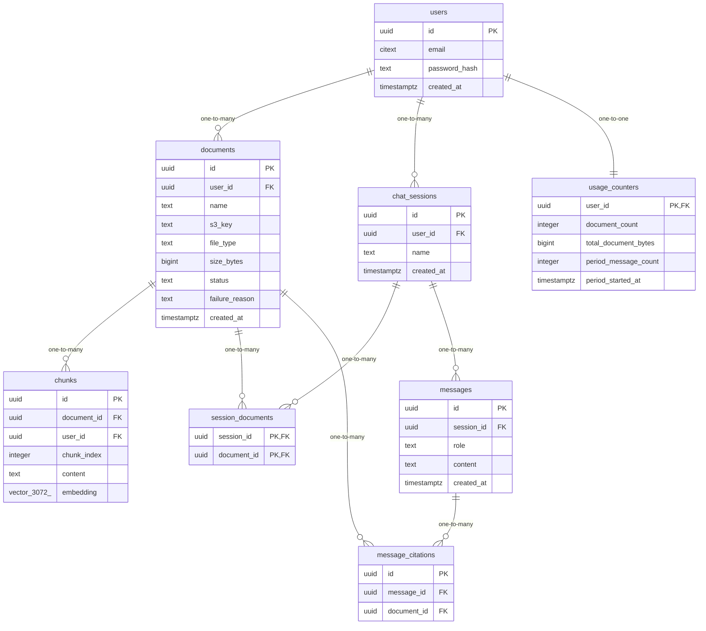

# Data Model

<!-- sdlc:auto:start entities -->
### users

| Field | Type | PK | FK | Nullable |
|---|---|---|---|---|
| id | uuid | True | — | False |
| email | citext | False | — | False |
| password_hash | text | False | — | False |
| created_at | timestamptz | False | — | False |

### documents

| Field | Type | PK | FK | Nullable |
|---|---|---|---|---|
| id | uuid | True | — | False |
| user_id | uuid | False | users.id | False |
| name | text | False | — | False |
| s3_key | text | False | — | False |
| file_type | text | False | — | False |
| size_bytes | bigint | False | — | False |
| status | text | False | — | False |
| failure_reason | text | False | — | True |
| created_at | timestamptz | False | — | False |

### chunks

| Field | Type | PK | FK | Nullable |
|---|---|---|---|---|
| id | uuid | True | — | False |
| document_id | uuid | False | documents.id | False |
| user_id | uuid | False | users.id | False |
| chunk_index | integer | False | — | False |
| content | text | False | — | False |
| embedding | vector(3072) | False | — | False |

### chat_sessions

| Field | Type | PK | FK | Nullable |
|---|---|---|---|---|
| id | uuid | True | — | False |
| user_id | uuid | False | users.id | False |
| name | text | False | — | False |
| created_at | timestamptz | False | — | False |

### session_documents

| Field | Type | PK | FK | Nullable |
|---|---|---|---|---|
| session_id | uuid | True | chat_sessions.id | False |
| document_id | uuid | True | documents.id | False |

### messages

| Field | Type | PK | FK | Nullable |
|---|---|---|---|---|
| id | uuid | True | — | False |
| session_id | uuid | False | chat_sessions.id | False |
| role | text | False | — | False |
| content | text | False | — | False |
| created_at | timestamptz | False | — | False |

### message_citations

| Field | Type | PK | FK | Nullable |
|---|---|---|---|---|
| id | uuid | True | — | False |
| message_id | uuid | False | messages.id | False |
| document_id | uuid | False | documents.id | False |

### usage_counters

| Field | Type | PK | FK | Nullable |
|---|---|---|---|---|
| user_id | uuid | True | users.id | False |
| document_count | integer | False | — | False |
| total_document_bytes | bigint | False | — | False |
| period_message_count | integer | False | — | False |
| period_started_at | timestamptz | False | — | False |
<!-- sdlc:auto:end entities -->

<!-- sdlc:auto:start relationships -->
| Source | Target | Type |
|---|---|---|
| users | documents | one-to-many |
| users | chat_sessions | one-to-many |
| users | usage_counters | one-to-one |
| documents | chunks | one-to-many |
| chat_sessions | session_documents | one-to-many |
| documents | session_documents | one-to-many |
| chat_sessions | messages | one-to-many |
| messages | message_citations | one-to-many |
| documents | message_citations | one-to-many |
<!-- sdlc:auto:end relationships -->

<!-- sdlc:auto:start er-diagram -->

<!-- sdlc:auto:end er-diagram -->
