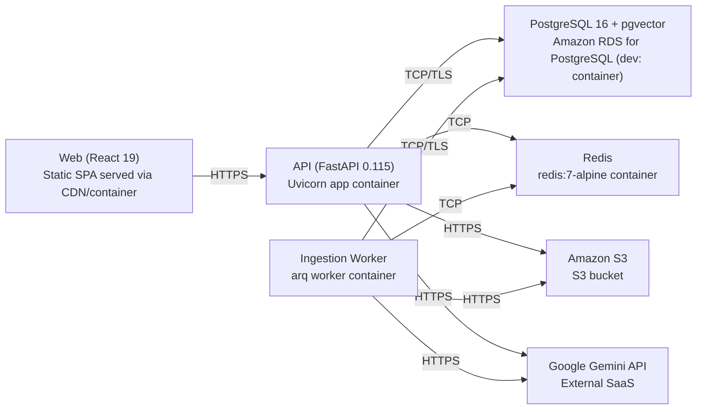

# Deployment Guide

> Maintained by QuorQ AI SDLC. Text between `sdlc:auto` markers is regenerated; anything outside them is yours and is kept.

<!-- sdlc:auto:start how-it-deploys -->
Pushes to `main` run `.github/workflows/deploy.yml`, which builds the API image (if there is a backend) and deploys the SPA to AWS Amplify. Commits touching only `docs/sdlc/**` don't deploy. Deployments can also be started from the platform's Deployment tab.
<!-- sdlc:auto:end how-it-deploys -->

<!-- sdlc:auto:start environments -->
| Name | Service | Runtime | Scaling | Environment |
|---|---|---|---|---|
| Web (React 19) | Static SPA served via CDN/container | Node build, static assets | Single dev instance | dev |
| API (FastAPI 0.115) | Uvicorn app container | Python 3.12 | Single dev container | dev |
| Ingestion Worker | arq worker container | Python 3.12 | Single dev worker, concurrency configurable | dev |
| PostgreSQL 16 + pgvector | Amazon RDS for PostgreSQL (dev: container) | PostgreSQL 16 with vector extension | Single instance | dev |
| Redis | redis:7-alpine container | Redis 7 | Single instance | dev |
| Amazon S3 | S3 bucket | Managed object storage | Managed | dev |
| Google Gemini API | External SaaS | Gemini API | Managed | dev |
<!-- sdlc:auto:end environments -->

<!-- sdlc:auto:start live -->
**Frontend URL:** https://pdc589fbd1d33.d3j61xaup4zgrx.amplifyapp.com

**Backend URL:** https://100-21-195-106.sslip.io/apps/dc589fbd1d33/

**Database:** PostgreSQL · app

**Version:** 16a6712eefb6

**Commit:** `16a6712`

**Finished:** 2026-10-27
<!-- sdlc:auto:end live -->

<!-- sdlc:auto:start topology -->

<!-- sdlc:auto:end topology -->
